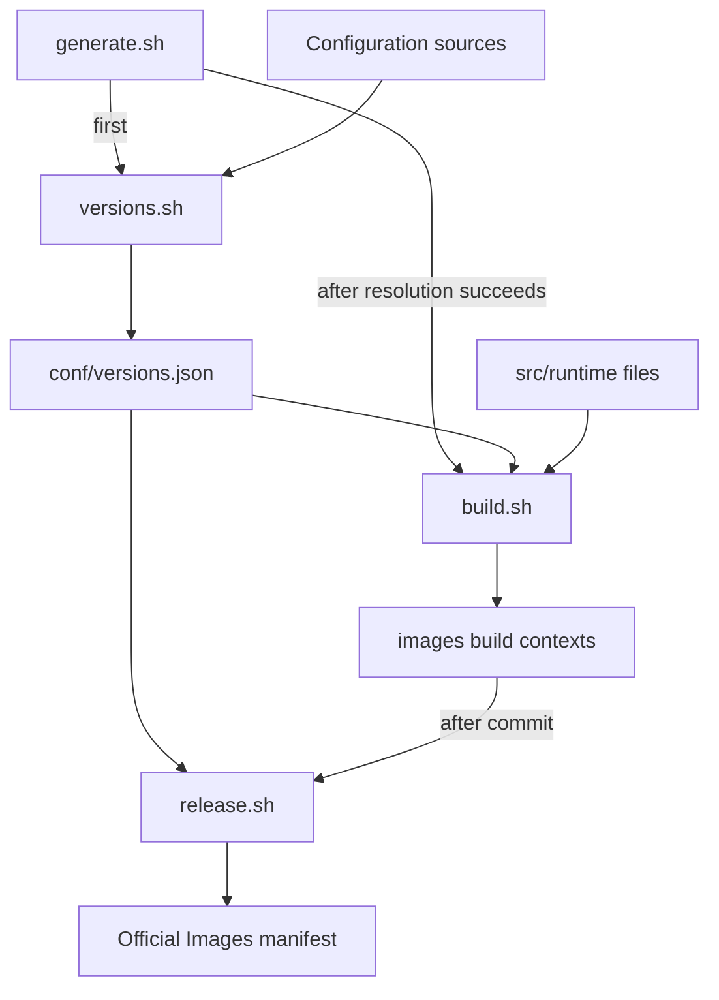
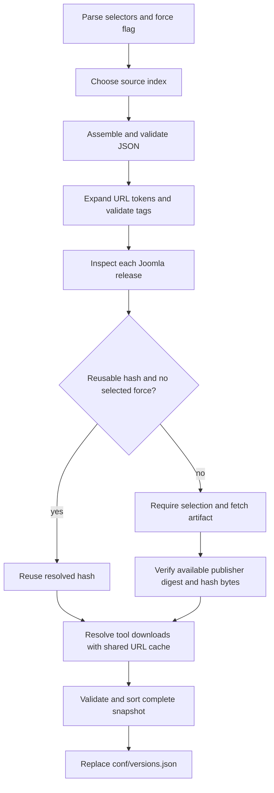
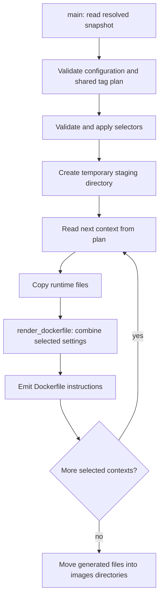

# How image generation works

This maintainer guide explains the scripts in execution order, so you can keep
the source open beside it. To run a published image, start with [usage](usage.md).
You do not need to be fluent in shell scripting. The scripts use
Bash to coordinate files and commands, and jq to read, validate and transform
JSON. They do not use Python or an external template engine.

Start with `generate.sh`, then read `src/build/versions.sh`, and finally
`src/build/build.sh`. For configuration changes rather than changes
to the generator, use [maintenance](maintenance.md) and the
[configuration reference](configuration.md).

## Three different operations

| Operation | Command | Result |
| --- | --- | --- |
| Resolve inputs and generate contexts | `./generate.sh` | Updates `conf/versions.json` and the selected directories under `images/` |
| Compile a container image | `docker build` with a generated context | Runs the instructions in a generated Dockerfile |
| Prepare the Official Images manifest | `./release.sh` | Writes a manifest to standard output using committed contexts |

The name `build.sh` refers to building the Dockerfiles and their accompanying
files. Running it does not run Docker, compile PHP extensions on your computer,
or start a Joomla container. Those actions happen later when Docker executes a
Dockerfile or starts an image.

`conf/versions.json` is the complete resolved configuration used for generation.
It contains exact download URLs and their hashes, along with the selected image
settings. Source files under `conf/joomla/` and `conf/php/` remain the files a
maintainer edits. The generated snapshot and contexts are committed so reviewers
and publication tools can inspect the exact build instructions.



## `generate.sh`: the coordinator

The root script is deliberately short. Read its argument loop and its final two
command invocations together:

1. It locates the repository from its own filename and changes to that directory.
   Invoking it through an absolute path therefore works from another directory.
2. It collects release selectors into the `targets` array. A selector is a series
   name or a series followed by `/` and a state name.
3. It passes the original arguments to `src/build/versions.sh`. This includes
   `--force`, when requested.
4. After successful resolution, it calls `src/build/build.sh` with the selectors.
   It does not pass `--force`, because rendering files has no download cache to
   refresh.

Without selectors, both stages process all configured tracks. A selected series
means all of its configured states; a selected track means that single state.
Selections do not turn off validation of the overall configuration or global
checks for conflicting tags.

Run `./generate.sh --help` for the current command syntax. For a selective run
without embedding a particular release number in a command:

```bash
jq -r 'to_entries[] | .key as $series | .value.states | keys[] | "\($series)/\(.)"' conf/versions.json
read -r -p 'Series or track to regenerate: ' target
./generate.sh "$target"
```

`set -e` stops the coordinator if the resolver fails, so it does not proceed to
render Dockerfiles from a failed resolution. This is sequencing, not a
transaction covering both stages: if resolution succeeds but rendering fails,
the new `conf/versions.json` remains. Fix the rendering problem and rerun before
committing the results.

## `versions.sh`: resolve a complete configuration

The resolver turns the small source files into a validated snapshot. It performs
network requests only when an explicit download needs resolution or refresh.



The release and tool steps are loops. The diagram shows the decision for each
artifact, not a single download for the whole repository. A rejected selector,
invalid configuration, failed request or checksum mismatch stops resolution.

### 1. Read arguments and choose the source index

At the top of the file, `force` starts as `false` and `targets` starts as an empty
array. The `case` statement handles help and force options, rejects unknown
options, and stores selectors. A trailing slash on a selector is removed.

The source index is chosen in this order:

1. The `VERSIONS_HELPER` environment variable, when set to a nonempty path.
2. `conf/.versions-helper.json`, when that local override exists.
3. The committed `conf/versions-helper.json`.

A relative `VERSIONS_HELPER` path is interpreted from the repository root. Paths
inside the chosen index are interpreted relative to the index file itself.
These are two different reference points; remember the distinction when putting
an experimental configuration outside the repository.

The script creates a temporary working directory and installs an `EXIT` trap to
remove it. Intermediate JSON and downloaded bytes go there rather than being
written over the committed snapshot as work proceeds.

### 2. Assemble the source files

Open `src/build/lib/assemble-config.sh` alongside the call
to it in `versions.sh`.

- `read_object()` requires one JSON object per source and rejects hash fields.
  The source files describe desired software; hashes belong in the resolved
  snapshot.
- `source_path()` resolves the index's paths.
- The loop over `phpVersions` and `joomlaVersions` discovers numeric JSON
  filenames in the configured directories. Stable filename ordering keeps
  assembly predictable. Adding a file does not require registering it in a
  shell array.
- The final jq expression selects each Joomla series' PHP profiles, applies its
  explicit overrides, includes or removes development settings, and attaches
  the shared archive definitions.

This assembly step does not download software. You can inspect its output with:

```bash
bash src/build/lib/assemble-config.sh conf/versions-helper.json | jq .
```

There are two intentional merge rules in the overall process. During source
assembly, overrides merge objects recursively and replace arrays and scalar
values. Later, during image rendering, normal, development and variant package
lists are combined. The distinction allows a series override to replace a
shared package list, while a development image can add tools to its normal
image. The [configuration reference](configuration.md) describes both rules.

### 3. Validate, expand URLs, and check tags

The call to `validate-config.jq` with `mode=helper` checks and normalizes the
assembled structure before downloads. Among other things, it checks release
states, PHP selections, supported archive formats, package settings and required
image fields.

The jq function `url()` then substitutes only the documented literal tokens:

- `{version}` uses the version of the release or tool containing the URL.
- `{packageType}` is also available in Joomla package URLs.

The same tool-version substitution applies to an optional publisher checksum
URL. Remaining braces are rejected, so an unsupported token cannot quietly
become part of a requested URL. These substitutions do not execute shell code.

The call to `tags.jq` checks the complete tag namespace. Each state's default PHP and variant select its short aliases, including
`latest` when explicitly assigned. Configured aliases, PHP suffixes, runtime
variants and development suffixes are expanded together. Prereleases must retain their state in their aliases; two
contexts cannot claim the same tag. This happens before network requests.

### 4. Resolve Joomla releases

The `selected()` function answers whether a release or series is covered by the
requested selectors. No selectors means every release is selected.

In the `for release` loop, the script reads the series, state, version and archive
format. It determines the full package URL, using the configured URL when one
is present. It compares that identity with the corresponding entry in the
existing `conf/versions.json`.

A Joomla cache entry can be reused when the version, URL and archive format
match and a correctly shaped SHA512 value exists. A selected `--force` refresh
bypasses that cache. If an unselected release is changed or unresolved, the
script fails and asks for it to be included; it does not quietly copy stale
metadata into the new snapshot.

For the canonical Joomla GitHub release URL, the resolver fetches the release
metadata, rejects drafts and mismatched tags, and requires the exact full-package
asset. If GitHub supplies a SHA256 digest for that asset, it verifies the
download against that digest. It calculates SHA512 from the downloaded bytes
for the generated image configuration.

For an explicitly configured alternative package URL, it downloads that URL and
calculates SHA512. It does not claim that calculating a hash independently
proves the publisher's identity. Choosing the source URL remains a maintainer
responsibility.

`fetch()` centralizes the curl options: HTTPS-only requests and redirects,
connection and total time limits, and bounded retries. `GITHUB_TOKEN` or
`GH_TOKEN`, when available, is used for the GitHub release metadata request.

### 5. Resolve downloaded tools

Find the comment beginning `Resolve every configured artifact generically` and
the `artifactHashes` associative array.

The resolver walks all `download` objects in the assembled configuration. It
does not need a `case` branch for each tool name: the source configuration
provides the version, full URL and installation metadata.

The full artifact URL is the cache key. When several PHP profiles or Joomla
series reference the same URL, the resolver resolves it once per run and reuses
the resulting SHA256. Before deciding whether `--force` applies, it checks all
series referencing that URL. This prevents file ordering from skipping a
refresh when a shared download is also used by an unselected series.

If a publisher checksum URL is configured, a freshly downloaded artifact must
also match that SHA256. Otherwise, the resolver records the SHA256 calculated
from the download. A valid cached hash is reused without fetching the artifact
or checksum again unless the relevant refresh is forced.

This loop handles only explicit `download` entries. Packages installed through
APT, APK, PIE, PECL and npm use their own installation pipelines; the resolver
does not add separate source archives or checksums for those packages.

### 6. Publish the snapshot

The final `validate-config.jq` call uses `mode=resolved`, which requires the
resolved hashes. `jq -S` writes object keys in a stable order. Only after that
succeeds does `mv` replace `conf/versions.json`.

The temporary result is created on the same filesystem as the destination, so
replacement of that single file uses a rename. A failed download or validation
before that point leaves the previous snapshot intact. The trap removes the
temporary working directory on a normal shell exit, including an error exit;
an uncatchable process termination or host failure can leave temporary files.

## `build.sh`: render self-contained Docker contexts

The renderer reads the resolved snapshot, validates the planned contexts, and
writes Dockerfiles. It does not resolve versions or fetch packages. The
maintainer label comes from `conf/maintainers.json`; runtime file contents come
from `src/runtime/`.



### 1. `main()`: validate and select the context plan

The `main()` function is near the end of the file. It finds the repository root,
checks for `conf/versions.json`, and runs the resolved configuration validator.
It then gets the shared context plan from `src/build/lib/tags.jq`.

Each item in that plan identifies a series, release state, PHP version, runtime
variant, development flag, directory and list of image tags. `build.sh`, CI and
`release.sh` use this same definition of the build matrix and directory names.
This is why a change to path or tag policy belongs in `tags.jq`, rather than in
separate loops in each consumer.

Selectors filter the plan after validation. The script renders into a temporary
staging directory first. For each context it copies `makedb.php` and the selected
entrypoint from `src/runtime/`. A series-specific
`docker-entrypoint-SERIES.sh` can override the common entrypoint when such a file
exists; `SERIES` here denotes the configured series name.

The resulting context contains its own `Dockerfile`, `docker-entrypoint.sh` and
`makedb.php`. Docker therefore needs only that context directory as its local
input. The Dockerfile does not reach outside the context to read the repository's
`src/` or `conf/` directories.

### 2. `render_dockerfile()`: choose settings for one image

The renderer receives six arguments: the resolved configuration filename,
series, state, PHP version, runtime variant and development flag.

Its first jq expression builds the effective image settings in order:

1. Start with the selected PHP profile.
2. Merge its `dev` settings when rendering a development image.
3. Merge the selected runtime variant.
4. Attach the selected release and archive extraction settings.

In this merge, objects combine by key, arrays append entries without duplicates,
and scalar values are replaced. The `config` map has a special rule: a later
file definition replaces the entire line list at that destination.

The function is written with parentheses, so each invocation runs in a subshell.
Its temporary shell variables and helper functions do not leak into another
context's rendering or into `main()`.

### 3. Formatting helpers: build shell commands as data

Read the small helper functions before following the installation code:

| Helper | Purpose |
| --- | --- |
| `quote()` | Formats one value as a literal shell argument |
| `words()` | Joins individually quoted arguments into a command fragment |
| `quote_configure()` | Preserves the explicitly supported build-time multiarch substitution in extension configure arguments |
| `json_words()` | Formats argument values read from JSON |
| `step()` | Appends a command to the current `steps` array |
| `list_step()` | Appends a command whose arguments appear on readable continued lines |
| `json_step()` | Reads a JSON list and passes its entries to `list_step()` |
| `emit_run()` | Prints one complete Docker `RUN` instruction and clears `steps` |
| `append_cleanup()` | Adds the selected distribution's cleanup commands from `lib/cleanup-apt.inc` or `lib/cleanup-apk.inc` |

Most of the function constructs strings to be executed **inside the future
image build**. For example, `$(nproc)` in an emitted command must be evaluated by
the image's shell, not while generating files on the maintainer's computer.
Quoting preserves that distinction. Literal configuration values are not fed to
`eval`.

The `${DEB_BUILD_MULTIARCH}` token is a specific exception handled by
`quote_configure()`. It is deliberately preserved for the Debian image build to
expand. It is not permission for arbitrary shell substitutions in JSON.

### 4. Emit installation, configuration and Joomla layers

The generated Dockerfile contains three principal `RUN` instructions:

| Layer | Work performed when Docker builds the image |
| --- | --- |
| Extensions and tools | Install runtime and temporary build dependencies; compile bundled PHP extensions; verify and install explicit downloads; install configured PIE, PECL and npm packages; enable modules; remove temporary tools and dependencies while retaining required runtime libraries |
| Runtime configuration and checks | Write PHP and server configuration, configure Apache where applicable, check PHP startup diagnostics and required modules, then run configured checks |
| Joomla release | Install temporary archive tools if needed, download and verify Joomla, extract its files, check expected entry files, set ownership and remove temporary extraction inputs |

The operating-system variant selects APT or APK mechanics. Software choices
come from JSON. The cleanup include files supply shell commands that are
emitted into the first layer; they are not host-side package cleanup scripts.

Direct-download URLs and hashes are declared once in the Dockerfile and used by
the download and verification commands. Joomla release declarations appear after
the extension and configuration layers, so a Joomla-only change can reuse
those earlier Docker build layers when their other inputs have not changed.

Finally, the renderer emits volume and working-directory settings, copies the
runtime files with explicit permissions, and writes `ENTRYPOINT` and `CMD`.
The installed container entrypoint is a separate runtime concern; its behaviour
is described in [using the images](usage.md).

### 5. Publish generated files

Only after all selected contexts render successfully does `main()` move their
files from staging into `images/`. A validation or rendering error before this
loop leaves the existing contexts untouched.

This final loop replaces files individually. It is not one atomic transaction
across all contexts: an interruption or filesystem error during publication can
leave some files updated. Rerun generation successfully and review the full diff
before committing. The generator also leaves retired contexts and unrelated
files alone; removing a release from configuration does not delete directories.
See [release maintenance](releases.md) for retiring them deliberately.

Do not run simultaneous generators against the same checkout. Unique temporary
directories isolate intermediate work, but the final snapshot and context paths
are shared and there is no locking protocol. Separate checkouts are appropriate
for independent work.

## `release.sh`: use committed outputs

Release manifest generation is deliberately separate from generation. The root
script reads the resolved configuration and shared context plan, checks each
selected context is committed and clean, and verifies its PHP parent and Joomla
version. It obtains architecture metadata for the PHP parents and writes the
Official Images fields, including each context's directory and commit.

The global `Builder: buildkit` field selects the modern builder used by CI and
publication. The `Generated by` URL identifies `release.sh` at the current
checkout's full commit hash. Each image's `GitCommit` is resolved independently
from the last change to its own context directory, including copied runtime
files. The script verifies that the pinned directory tree matches the current
committed context. A documentation-only commit updates the generator URL without
changing any image pins. Full Git history and clean, committed release inputs
are required so the manifest can identify its source accurately.

The script buffers the complete manifest and prints it only after all contexts
pass validation. Diagnostics go to standard error. That permits the simple
release command:

```bash
./release.sh > ../official-images/library/joomla
```

Shell redirection opens the destination before `release.sh` starts. A failed
release therefore emits no partial manifest, but can leave that destination
empty. Check the command succeeded and review the diff in `official-images`
before committing. The complete publication procedure is in
[publishing](publishing.md).

## Shell syntax used in these files

These are the main idioms to recognize while reading the source:

| Syntax | Meaning in this project |
| --- | --- |
| `set -Eeuo pipefail` | Enables error-trap inheritance, stops on many unhandled command failures, rejects unset variables, and makes a failed command within a pipeline affect its status. Shell conditions and several other contexts intentionally handle failures themselves; this is not exception handling for every possible error. |
| `name="$(command)"` | Runs a command and stores its standard output, with trailing newlines removed. This is how shell variables receive jq results. |
| `"$value"` | Expands one value while preserving spaces and wildcard characters as part of that value. |
| `"${targets[@]}"` | Passes each array element as a separate argument. This preserves the selector boundaries. |
| `${value:-default}` | Uses a fallback when the variable is unset or empty. |
| `${path##*/}` and `${name%.json}` | Remove a matching prefix or suffix, such as a directory path or filename extension. |
| `if command; then` | Tests the command's exit status. Exit status zero means success; other statuses mean failure. |
| `while IFS= read -r value` | Reads complete lines without treating backslashes as escapes or trimming them through field splitting. |
| `mapfile -t values` | Reads lines into a Bash array and removes their trailing newline characters. |
| `done < <(command)` | Feeds a command's output into a loop through process substitution. The loop remains in the current shell, so its variable updates remain available afterward. |
| `<<<"$json"` | Sends a string to a command's standard input. |
| `> file`, `>> file`, and `>&2` | Replace a file with output, append output, or send a diagnostic to standard error. |
| `trap '...' EXIT` | Registers cleanup to run when that shell exits. It has a role similar to a `finally` block, subject to the process-termination limits described above. |
| `function_name() ( ... )` | Runs the function body in a subshell, containing its variable and directory changes. |

A subtle point: `pipefail` applies to pipelines; it does not automatically
propagate the exit status of a process-substitution producer into its consumer.
The scripts validate their configuration and main plans explicitly before using
many of those streams. When changing this code, keep fallible validation in a
checked command rather than assuming a surrounding `while` or `mapfile` will
catch every producer failure.

Bash is the host scripting language here. Features such as arrays, `mapfile` and
process substitution are not POSIX `sh` syntax. Run the executable scripts or
invoke them with `bash`, not `sh`. The shell selected **inside** a generated
Dockerfile is a separate choice for that image's distribution.

## Reading the jq expressions as a PHP developer

jq operates on JSON values rather than shell strings. The shell passes a JSON
value into jq and receives transformed JSON or a selected scalar back.

| jq expression | Useful PHP analogy |
| --- | --- |
| `.states` | Read the `states` member of the current object |
| `.[]` | Iterate the values of the current object or array |
| `to_entries[]` | Iterate key/value pairs, similar to `foreach ($data as $key => $value)` |
| `map(expression)` | Transform every array element, similar to `array_map` |
| `select(condition)` | Keep matching values, similar to a filtering predicate |
| `with_entries(...)` | Transform an object's key/value pairs while producing an object again |
| `. as $settings` | Bind the current value to a variable for later expressions |
| `reduce ...` | Accumulate a result through repeated steps |
| `require(...)` in these files | A project-defined validation function that raises a jq error when a condition fails |

A jq pipe connects transformations inside jq. It is different from the shell's
pipe connecting separate programs. `jq --arg` supplies a string variable;
`--argjson` supplies a parsed JSON value. Passing external values this way avoids
constructing jq source code by interpolating them.

Common output flags are `-r` for raw strings, `-c` for compact JSON, `-S` for
sorted object keys and `-e` for an exit status reflecting whether the final
result is false, null or missing. Check the surrounding shell condition when
reading a `jq -e` call: some calls deliberately ask a yes/no question rather
than report an invalid configuration.

## Inspect the flow without changing release values

From the repository root, these commands let you inspect each data shape:

```bash
# Assembled source configuration, before download hashes are added.
bash src/build/lib/assemble-config.sh conf/versions-helper.json | jq .

# Validate the committed resolved configuration without replacing it.
jq --arg mode resolved -f src/build/lib/validate-config.jq conf/versions.json > /dev/null

# Show the shared plan used for context directories and publication tags.
jq -f src/build/lib/tags.jq conf/versions.json
```

To run the stages separately, use:

```bash
./src/build/versions.sh
./src/build/build.sh
```

The first command can update the resolved snapshot; the second can update image
contexts. The same outputs are produced in that order by `./generate.sh`.

Deterministic generation means the same resolved settings, maintainer metadata,
runtime files and generator code produce the same context files. It does not
promise byte-identical container images: mutable base-image tags and package
repositories are additional inputs when Docker builds an image. A committed
download hash ensures the build accepts only bytes matching that hash; forcing
resolution intentionally establishes a newly reviewed hash from the configured
source.

See [testing](testing.md) for the checks that protect these contracts and
[configuration](configuration.md) for the fields each stage consumes.
